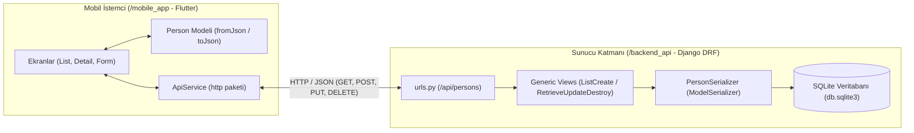

# Kişi Yönetim Sistemi (Client-Server REST Mimarisi)

**Mobil Programlama Dersi — Vize Sınavı Proje Çalışması (2026-2027 Güz)**

Bu proje, **Flutter (Dart)** tabanlı mobil istemci (`/mobile_app`) ile **Django REST Framework (Python)** tabanlı bağımsız web servisinin (`/backend_api`) HTTP/REST protokolü ve JSON veri formatı üzerinden tam entegre (CRUD) çalışmasını sağlar.

---

## 1. Proje Mimarisi ve Dizin Yapısı



```text
.
├── backend_api/                        # Django REST Framework Sunucu Katmanı (Python + SQLite)
│   ├── config/
│   │   ├── settings.py                 # Django, DRF ve CORS yapılandırması
│   │   └── urls.py                     # Ana URL yönlendirmesi (/api/)
│   ├── persons/
│   │   ├── migrations/                 # Veritabanı şeması ve başlangıç (seed) verileri
│   │   ├── models.py                   # Person veritabanı modeli (ORM)
│   │   ├── serializers.py              # Model <-> JSON dönüşüm sınıfı (PersonSerializer)
│   │   ├── urls.py                     # /api/persons ve /api/persons/<int:pk> uç noktaları
│   │   └── views.py                    # DRF Generic CRUD görünümleri
│   ├── db.sqlite3                      # Yerel SQLite veritabanı
│   ├── manage.py                       # Django yönetim betiği
│   └── requirements.txt                # Python paket bağımlılıkları
│
├── mobile_app/                         # Flutter Mobil İstemci Katmanı (Dart)
│   ├── android/                        # Android platform ve Intent (<queries>) yapılandırması
│   ├── lib/
│   │   ├── main.dart                   # Uygulama giriş noktası ve merkezi Material 3 teması
│   │   ├── models/
│   │   │   └── person.dart             # JSON <-> Dart veri modeli (fromJson / toJson)
│   │   ├── services/
│   │   │   └── api_service.dart        # Asenkron HTTP istekleri (GET, POST, PUT, DELETE)
│   │   └── screens/
│   │       ├── person_list_screen.dart   # 1. Kişi Listesi (Ana Sayfa + FAB + URL Ayarı)
│   │       ├── person_detail_screen.dart # 2. Kişi Detay Sayfası (Intent + Düzenle/Sil)
│   │       └── person_form_screen.dart   # Yeni Kişi Kayıt ve Güncelleme Formu
│   ├── release/
│   │   └── kisi_yonetim_sistemi.apk    # Doğrudan kurulabilir derlenmiş Android APK paketi
│   └── pubspec.yaml                    # Flutter paket bağımlılıkları (http, url_launcher)
│
└── README.md                           # Kurulum, çalıştırma ve test kılavuzu
```

---

## 2. Backend API Servisinin Yerelde Kurulumu (`/backend_api`)

### Ön Gereksinimler
- **Python 3.10+** ve `pip`

### Adım Adım Kurulum ve Çalıştırma

1. Terminal açarak `backend_api` klasörüne geçin:
   ```bash
   cd backend_api
   ```

2. Python sanal ortamı (virtual environment) oluşturun ve etkinleştirin:
   ```bash
   # Windows (PowerShell)
   python -m venv venv
   .\venv\Scripts\Activate.ps1

   # macOS / Linux
   python3 -m venv venv
   source venv/bin/activate
   ```

3. Gerekli Python paketlerini (`django`, `djangorestframework`, `django-cors-headers`) yükleyin:
   ```bash
   pip install -r requirements.txt
   ```

4. SQLite veritabanı tablolarını ve başlangıç örnek kişi kayıtlarını oluşturun:
   ```bash
   python manage.py migrate
   ```

5. API sunucusunu başlatın:
   ```bash
   python manage.py runserver 0.0.0.0:8000
   ```
   > **Not:** `0.0.0.0:8000` parametresi sayesinde hem yerel makineden (`http://127.0.0.1:8000`), hem Android Emülatörden (`http://10.0.2.2:8000`), hem de aynı Wi-Fi ağındaki fiziksel cihazlardan erişim sağlanır.

---

## 3. REST Veri Şeması ve Uç Noktalar

| HTTP Metodu | Uç Nokta | İşlem / Görev Açıklaması | Başarı Kodu |
| :--- | :--- | :--- | :---: |
| `GET` | `/api/persons` | Tüm kişileri dizi (`array`) formatında listeler. | `200 OK` |
| `GET` | `/api/persons/{id}` | Belirtilen ID'ye sahip kişinin tüm detaylarını döner. | `200 OK` |
| `POST` | `/api/persons` | Yeni kişi kaydı oluşturur (Form body JSON). | `201 Created` |
| `PUT` | `/api/persons/{id}` | Kişinin iletişim ve unvan bilgilerini günceller. | `200 OK` |
| `DELETE` | `/api/persons/{id}` | İlgili kaydı veritabanından kalıcı olarak siler. | `204 No Content` |

### Örnek Kişi JSON Şeması (Payload)

```json
{
  "id": 104,
  "fullName": "Ahmet Yılmaz",
  "department": "Yazılım Geliştirme",
  "photoUrl": "https://cdn.site/p/104.png",
  "birthPlace": "Adana",
  "birthDate": "1994-04-12",
  "email": "ahmet.yilmaz@sirket.com",
  "phone": "+905550123456"
}
```

---

## 4. Mobil Uygulama Kurulum ve Test Kılavuzu (`/mobile_app`)

### Ön Gereksinimler
- **Flutter SDK (3.x+)**
- Android Emülatör veya fiziksel Android cihaz

### Adım Adım Çalıştırma

1. Yeni bir terminalde `mobile_app` klasörüne gidin:
   ```bash
   cd mobile_app
   ```

2. Paket bağımlılıklarını indirin:
   ```bash
   flutter pub get
   ```

3. Uygulamayı aktif emülatör veya cihazda başlatın:
   ```bash
   flutter run
   ```

### Sunucu Bağlantı Adresi Yapılandırması
- **Android Emülatör:** Varsayılan olarak `http://10.0.2.2:8000/api/persons` adresini kullanır.
- **Fiziksel Android Telefon:** Uygulama ana sayfasının sağ üst köşesindeki **Ayarlar (`⚙️`)** ikonuna dokunarak bilgisayarınızın yerel Wi-Fi IP adresini (örn. `http://192.168.1.35:8000/api/persons`) çalışma zamanında girebilirsiniz.

### Çalıştırılabilir APK Test Paketi
- **Hazır Derlenmiş APK Dosyası:** [`mobile_app/release/kisi_yonetim_sistemi.apk`](mobile_app/release/kisi_yonetim_sistemi.apk) (Doğrudan Android cihaza yüklenebilir).
- Yeniden derlemek için:
  ```bash
  cd mobile_app
  flutter build apk --release --split-per-abi
  ```
